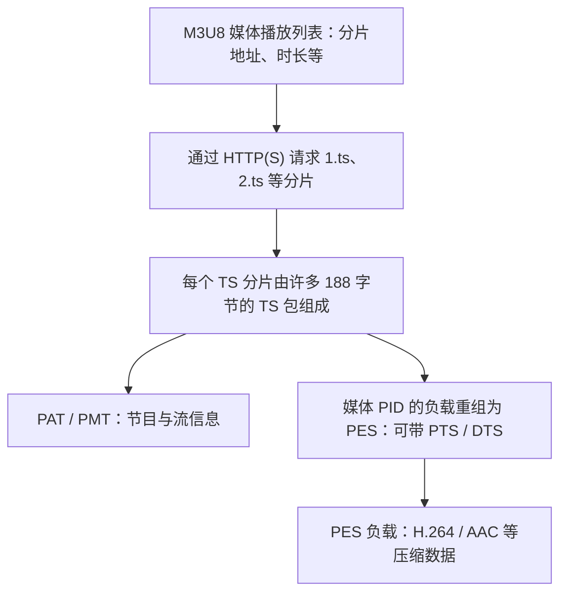
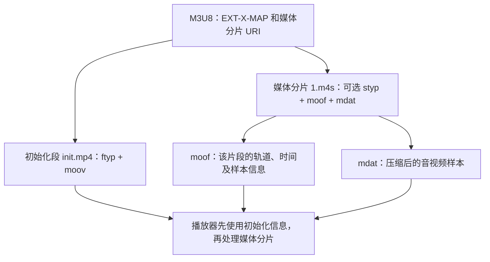

# 流媒体：HLS、容器与编码

## 先分清层级

这些名字经常写在一起，但不是同一层：

| 层级 | 常见名字 | 作用 |
| --- | --- | --- |
| 流媒体协议 | HLS | 规定播放列表、媒体分片和客户端加载规则，通常通过 HTTP(S) 分发 |
| 播放列表 | M3U8 | UTF-8 文本，描述可选码率或媒体分片的地址、时长等信息 |
| 文件后缀 | `.ts`、`.mp4`、`.m4s` | 文件名的约定，不能只靠后缀判断实际内容 |
| 容器 | MPEG-TS、MP4 / fMP4、MPEG-PS | 组织压缩后的音视频数据及时间戳、索引等信息 |
| 视频编码 | H.264 / AVC、H.265 / HEVC、AV1 | 画面怎么压缩 |
| 音频编码 | AAC、Opus | 声音怎么压缩 |

下面是常见的 HLS 搭配，不表示任意容器、编码都能自由组合：

```text
主播放列表（可选，列出不同码率）
  └── 媒体播放列表（列出分片）
        ├── MPEG-TS 分片：常见 H.264 + AAC
        └── fMP4 分片：常见 H.264 / HEVC + AAC，另需初始化段
```

`.m4s` 是文件后缀，fMP4 是分片式 MP4 的组织方式，两者属于不同层级。MP4 基于 ISO BMFF；fMP4 仍使用这套盒子体系，不是与 MP4 无关的容器。

容器能装某种编码，不等于 HLS 规范、播放器和目标设备都支持这种组合。AV1、Opus 等需要另外核对封装、客户端实现和设备能力；不能因为它们是编码格式，就默认能放进任意 TS / fMP4 流播放。

## 浏览器能播什么

H.264 + AAC + MP4 是兼容性较广的组合，但不能说浏览器一定能播放 H.264。实际支持还受操作系统、浏览器构建、编码的 Profile / Level、位深、分辨率等影响；解码能力也可能由操作系统或硬件提供。

播放需要几个条件同时满足：

| 条件 | 需要检查什么 |
| --- | --- |
| 编码 | 浏览器是否支持实际使用的音视频编码及其参数 |
| 容器 | 播放器是否能解析该容器，或先转封装成支持的格式 |
| 播放路径 | 直接播放 MP4、原生 HLS 和通过 MSE 播放的支持范围可能不同 |
| 资源访问 | 地址、鉴权、跨域、HTTPS、加密与 DRM 等是否满足要求 |

直接播放可用 `video.canPlayType(mimeType)` 初步探测；MSE 路径可用 `MediaSource.isTypeSupported(mimeType)`。MIME 应包含实际的 codecs 参数，探测通过仍需实际加载验证。参见 [HTML 媒体能力探测](https://html.spec.whatwg.org/multipage/media.html#dom-navigator-canplaytype-dev)。

## MP4 与 moov

普通非分片 MP4 中，`mdat` 保存压缩后的媒体样本；`moov` 保存轨道、编码配置、时长及样本表等元数据。它不只是一个简单的“索引盒”。

- `moov` 可以位于媒体数据之前或之后。将它移到前面（常称 fast start），有利于边下载边播放。
- `moov` 在尾部时，支持范围请求的服务器可让播放器先读取尾部；并不一定要下载完整文件才能播放。
- `stco` / `co64` 记录媒体 chunk 的绝对文件偏移，通常指向 `mdat` 内的数据，不是 `mdat` 盒子头。

下面只是普通 MP4 的简化结构示意，不是某个实际文件的解析结果；真实层级和偏移必须检查文件：

```text
ftyp
moov
  mvhd                         影片级时基、时长等
  trak                         一条轨道，音视频通常分别建轨
    tkhd                       轨道 ID、显示尺寸等
    mdia
      mdhd                     该轨道的时基、时长等
      hdlr                     vide 表示视频，soun 表示音频
      minf
        stbl
          stsd                 样本描述，如 avc1 及 avcC 编码配置
          stts / ctts           解码时序 / 显示时间偏移（ctts 可选）
          stsc / stsz           chunk 与样本的映射 / 样本大小
          stco 或 co64          chunk 在文件中的字节偏移
mdat                           实际媒体样本
```

fMP4 会将各片段的时间和样本信息放进 `moof`，不能把这份普通 MP4 的完整样本表结构直接套到 fMP4 初始化段上。

## MPEG-TS

TS 是 Transport Stream（传输流）的缩写。标准 TS 包长为 **188 字节**，不是 188 个字符；其中包含包头，因此并非每包都有 188 字节的媒体负载。

- PID 标识不同用途的数据流，如节目表、视频或音频。
- PAT / PMT 描述节目与音视频流的关系，不是每个 TS 包都同时带这两张表。
- 音视频通常先封装成 PES，再拆入多个 TS 包。
- PTS / DTS 位于适用的 PES 头中，并非每个 TS 包的包头都有；PCR 位于部分 TS 包的适配字段中，帮助恢复时钟。



M3U8 只引用媒体资源，不包含 TS 文件本身。HTTP 负责传输资源，不负责选择清晰度。播放器根据带宽、缓冲等情况，从服务端预先提供的多个码率版本中选择；服务端没有准备 720p 时，播放器不能自动把 1080p 压成 720p。

分片时长由内容制作配置决定，2–6 秒只是常见量级，不是 HTTP 或 HLS 的固定要求。客户端也不必严格一次只请求一个分片。

## fMP4

fMP4 是 fragmented MP4 的缩写。HLS 中通常先加载初始化段，再加载媒体分片：

- 初始化段常命名为 `init.mp4`，包含 `ftyp` 和 `moov`，描述轨道、编码配置等，不是只有 `moov`。
- 媒体分片常命名为 `.m4s`，基本结构是 `moof` + `mdat`，还可能有 `styp` 等盒子。
- `tfdt` 给出轨道片段的基准解码时间；`tfhd` / `trun` 等共同描述样本的时长、大小、偏移等，部分默认值还可来自初始化段的 `trex`。



初始化段和媒体分片可以是不同文件，也可以通过字节范围引用同一资源中的不同部分。上述盒子结构可参照 [W3C ISO BMFF 字节流格式](https://www.w3.org/TR/mse-byte-stream-format-isobmff/)。

TS 转 fMP4 叫转封装（transmux / remux）；H.265 转 H.264 叫转码（transcode）。目标容器和客户端支持原编码时，通常可以只转封装，无须重新压缩音视频，但仍可能需要调整码流表示、时间戳和编码配置。不能通过改文件后缀完成转换。

切换清晰度还需要不同版本的时间线和关键帧对齐，并正确处理初始化信息、编码兼容性等条件，不是时间戳连续就一定能切换。

## MPEG-PS 与监控

PS 是 Program Stream（节目流）的缩写，也属于容器 / 系统层格式。它既用于存储，也可承载网络传输中的音视频，不能简单等同于录像文件格式。

在 GB/T 28181 监控联网场景中，PS over RTP 很常见。标准还涉及视音频基本流的 RTP 封装及不同业务的媒体传输要求，不能笼统写成“所有 RTP 负载必须是 PS”。应按所采用的标准版本、业务和设备协商结果确认。标准信息见 [公安标准化信息服务平台：GB/T 28181-2022](https://ywtb.mps.gov.cn/gabzh/portal/stdDetail/313810)。

为什么常用 PS？主要是标准约定、已有设备支持和互联互通的要求，不能单凭“监控不切台”推导出 TS 不适合监控。TS 也能只承载一个节目，实际开销取决于复用、填充和节目表发送频率等。

为什么不直接用普通 MP4？普通 MP4 如果在结束录制时才写完关键元数据，异常断电可能导致文件无法直接播放；但这取决于录制与落盘策略。fMP4、分段录制、定期保存元数据都能改善恢复能力。PS / TS 也可能丢失未落盘的数据，恢复播放还受关键帧和码流完整性影响，不能保证“最多只丢最后几秒”。

## 为什么选择 H.265

H.265 通常比 H.264 有更高的压缩效率，但“相同画质一定节省一半带宽和空间”不是保证。收益取决于内容、编码器、参数与画质评价方式，还要考虑编码成本和客户端解码兼容性。

存储量首先由实际平均码率和录制时长决定。下面**假设** H.264 为 4 Mbps、H.265 为 2 Mbps，只计算视频数据，不含音频、容器、网络或文件系统开销，也不代表两种编码在这些码率下一定画质相同：

| 指标 | H.264（假设 4 Mbps） | H.265（假设 2 Mbps） |
| --- | --- | --- |
| 录像 1 小时 | 1.8 GB | 0.9 GB |
| 录像 24 小时 | 43.2 GB | 21.6 GB |
| 录像 30 天 | 1.296 TB | 0.648 TB |

计算公式：字节数 = 码率（bit/s）× 时长（秒）÷ 8。这里 GB / TB 使用十进制单位，1 GB = 10⁹ 字节、1 TB = 10¹² 字节。

## M3U8 播放列表

HLS 有两类核心播放列表：主播放列表列出不同码率 / 分辨率等版本，媒体播放列表列出具体媒体分片。下面的标签和分片示例属于媒体播放列表。

| 标签 | 含义 |
| --- | --- |
| `#EXTM3U` | 文件标识，必须是第一行 |
| `#EXT-X-VERSION` | 使用这些标签与功能所需的协议兼容版本，不是编码版本 |
| `#EXT-X-TARGETDURATION` | 目标分片时长，单位秒，取整数；不是文件大小。按 RFC 8216，各 EXTINF 时长四舍五入到整数后不得超过它 |
| `#EXTINF` | 紧随其后的媒体分片时长，单位秒 |
| `#EXT-X-MEDIA-SEQUENCE` | 列表中第一个媒体分片的序列号；后续依次加一，与文件名无关，省略时默认为 0 |
| `#EXT-X-MAP` | 声明后续分片所需的媒体初始化区段；fMP4 HLS 需要它，但它不是只用于 fMP4 的格式标识 |
| `#EXT-X-PLAYLIST-TYPE` | 可选的 VOD / EVENT 类型；VOD 不允许更新，EVENT 允许向末尾追加 |
| `#EXT-X-ENDLIST` | 不会再向这个媒体播放列表添加分片；不是“当前列表为空”，也不代表必然是 VOD |

### TS 点播示例

```m3u8
#EXTM3U
#EXT-X-VERSION:3
#EXT-X-TARGETDURATION:3
#EXT-X-MEDIA-SEQUENCE:0
#EXT-X-PLAYLIST-TYPE:VOD
#EXTINF:3.000,
seg0.ts
#EXTINF:3.000,
seg1.ts
#EXT-X-ENDLIST
```

### fMP4 点播示例

```m3u8
#EXTM3U
#EXT-X-VERSION:7
#EXT-X-TARGETDURATION:3
#EXT-X-MEDIA-SEQUENCE:0
#EXT-X-PLAYLIST-TYPE:VOD
#EXT-X-MAP:URI="init.mp4"
#EXTINF:3.000,
seg0.m4s
#EXTINF:3.000,
seg1.m4s
#EXT-X-ENDLIST
```

第二个示例选择版本 7；按 RFC 8216，普通媒体播放列表使用 `EXT-X-MAP` 至少需要版本 6，因此不能沿用前一个 TS 示例的版本 3。标签行中不要附加箭头或中文解释，以免被当成标签内容。

进行中的直播通常没有 `ENDLIST`，滑动窗口可以移除旧分片，此时首分片序列号随之增加。EVENT 播放列表只能追加，活动结束后也可以添加 `ENDLIST`；直播结束时同样可以添加它，所以不能用“有它就是点播，没有就是直播”来分类。标签语义参见 [RFC 8216 第 4、6、7 节](https://www.rfc-editor.org/rfc/rfc8216.html)。

## 原生 HLS、hls.js 与 MSE

Safari 等环境常提供原生 HLS 支持，可以将 M3U8 地址赋给 `video.src`；但仍需检查实际环境、资源访问和媒体兼容性，不能只按“苹果设备”判断一定可播。

hls.js 提供播放列表解析、分片加载、码率选择、缓冲管理等能力。TS 输入通常会转封装为 fMP4，再交给 MSE；已有的 fMP4 分片通常直接交给 MSE。hls.js 不会自动把 H.265 转成 H.264，因此浏览器缺少对应解码能力时，仍需服务端转码或提供另一种编码版本。参见 [hls.js 官方说明](https://github.com/video-dev/hls.js)。

### MSE 追加片段示例

下面只演示“请求已经制作好的 fMP4 → 依次追加到 SourceBuffer”，不是完整的 hls.js 实现，也不会读取 M3U8 或处理 TS、直播、切清晰度、加密和缓冲回收。

运行前需要：

- 页面提供 `<video id="video" controls></video>`，在元素创建后运行脚本。
- 同源 HTTP(S) 服务提供 `/video/init.mp4` 和 `/video/seg0.m4s`、`seg1.m4s`；这些文件必须来自同一套连续时间线，并与初始化段匹配。
- `/video/media-info.json` 提供真实的 MIME / codecs。下面的值仅是假设素材为 AVC + AAC-LC 的示例，必须按实际轨道和参数生成，不能照抄用于 HEVC 等素材。
- 示例将音视频复用到同一个 SourceBuffer；若素材是音视频分轨，需要分别加载初始化段并管理各自的 SourceBuffer。

```json
{
  "mimeType": "video/mp4; codecs=\"avc1.42E01E, mp4a.40.2\""
}
```

脚本按片段下载、追加，并等待 `updateend` 后处理下一段。只适合少量短片段；大文件或直播还需要限制前向缓冲、清理旧数据、处理配额不足及重试等。点击视频控件播放，示例不主动触发自动播放。

```js
const video = document.getElementById('video');

if (!(video instanceof HTMLVideoElement)) {
  throw new Error('找不到 #video 视频元素');
}

if (!('MediaSource' in window)) {
  throw new Error('当前环境不支持本示例使用的 MediaSource API');
}

function createMseDemo(videoElement) {
  const mediaSource = new MediaSource();
  const objectUrl = URL.createObjectURL(mediaSource);
  const controller = new AbortController();
  const { signal } = controller;
  let disposed = false;
  let objectUrlReleased = false;

  function releaseObjectUrl() {
    if (objectUrlReleased) {
      return;
    }

    URL.revokeObjectURL(objectUrl);
    objectUrlReleased = true;
  }

  function dispose() {
    if (disposed) {
      return;
    }

    disposed = true;
    controller.abort();
    releaseObjectUrl();
    videoElement.removeAttribute('src');
    videoElement.load();
  }

  async function fetchResource(url) {
    const response = await fetch(url, { signal });

    if (!response.ok) {
      throw new Error(url + ' 请求失败：HTTP ' + response.status);
    }

    return response;
  }

  async function loadMimeType() {
    const response = await fetchResource('/video/media-info.json');
    const mediaInfo = await response.json();
    const { mimeType } = mediaInfo;

    if (typeof mimeType !== 'string' || !MediaSource.isTypeSupported(mimeType)) {
      throw new Error('无效或不支持的 MIME：' + mimeType);
    }

    return mimeType;
  }

  function appendBuffer(sourceBuffer, data) {
    return new Promise((resolve, reject) => {
      function cleanup() {
        sourceBuffer.removeEventListener('updateend', onUpdateEnd);
        sourceBuffer.removeEventListener('error', onError);
        sourceBuffer.removeEventListener('abort', onError);
        signal.removeEventListener('abort', onAbort);
      }

      function onUpdateEnd() {
        cleanup();
        resolve();
      }

      function onError() {
        cleanup();
        reject(new Error('SourceBuffer 追加失败或被中止'));
      }

      function onAbort() {
        cleanup();
        reject(new DOMException('已停止加载', 'AbortError'));
      }

      if (signal.aborted) {
        onAbort();
        return;
      }

      sourceBuffer.addEventListener('updateend', onUpdateEnd);
      sourceBuffer.addEventListener('error', onError);
      sourceBuffer.addEventListener('abort', onError);
      signal.addEventListener('abort', onAbort, { once: true });

      try {
        sourceBuffer.appendBuffer(data);
      } catch (error) {
        cleanup();
        reject(error);
      }
    });
  }

  async function loadSegments(sourceBuffer) {
    const names = ['init.mp4', 'seg0.m4s', 'seg1.m4s'];

    for (const name of names) {
      const response = await fetchResource('/video/' + name);
      const data = await response.arrayBuffer();
      await appendBuffer(sourceBuffer, data);
      console.log('已追加：', name);
    }
  }

  function fail(error) {
    if (disposed) {
      return;
    }

    console.error('MSE 加载失败：', error);
    dispose();
  }

  async function onSourceOpen() {
    releaseObjectUrl();

    try {
      const mimeType = await loadMimeType();
      const sourceBuffer = mediaSource.addSourceBuffer(mimeType);
      await loadSegments(sourceBuffer);

      if (disposed) {
        return;
      }

      mediaSource.endOfStream();
      console.log('所有片段追加完成，可点击视频控件播放');
    } catch (error) {
      fail(error);
    }
  }

  mediaSource.addEventListener('sourceopen', onSourceOpen, { once: true, signal });
  mediaSource.addEventListener('sourceclose', () => {
    fail(new Error('MediaSource 意外关闭'));
  }, { signal });
  videoElement.addEventListener('error', () => {
    const detail = videoElement.error?.message || videoElement.error?.code || '未知错误';
    fail(new Error('video 错误：' + detail));
  }, { signal });
  window.addEventListener('pagehide', dispose, { once: true, signal });
  videoElement.src = objectUrl;

  return dispose;
}

const disposeMseDemo = createMseDemo(video);
// 单页应用卸载组件时调用 disposeMseDemo()。
```
