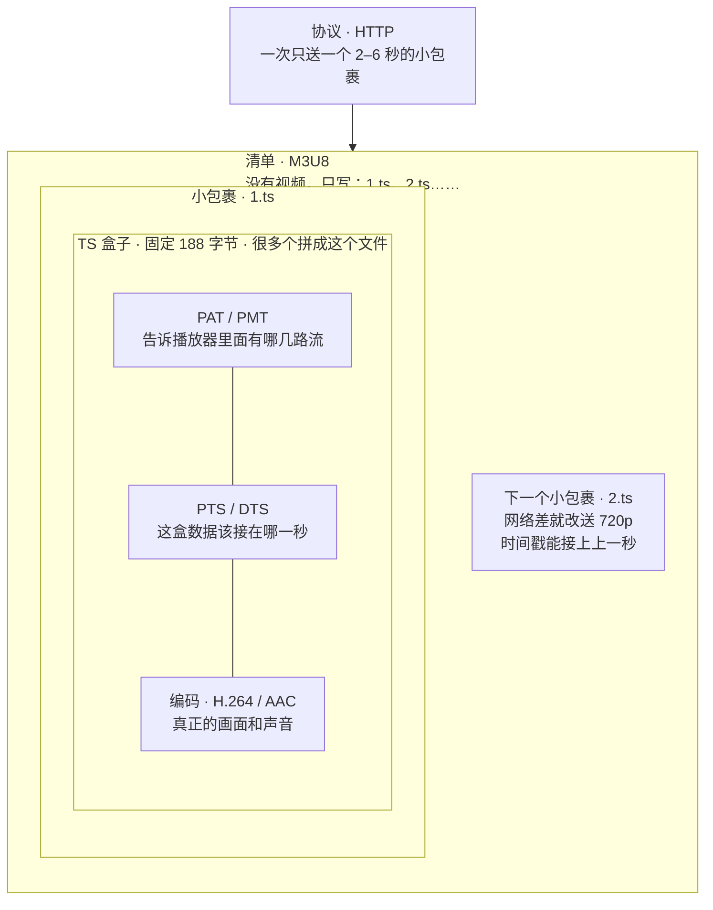

# 流媒体

## 先分清层级

这些名字经常写在一起，但不是同一层：

| 层级 | 常见名字 | 作用 |
| --- | --- | --- |
| 播放列表 | `.m3u8` | 告诉播放器有哪些分片、按什么顺序播 |
| 文件后缀 | `.ts`、`.mp4`、`.m4s` | 只是文件名，对应下面的容器 |
| 容器 | MPEG-TS、MP4、fMP4 | 压缩后的数据怎么装箱、怎么切片 |
| 视频编码 | H.264、H.265、AV1 | 画面怎么压缩 |
| 音频编码 | AAC、Opus | 声音怎么压缩 |

对应关系：

```text
.m3u8 播放列表
  └── .ts 或 .m4s 分片（容器）
        ├── 视频：H.264 / H.265 / AV1
        └── 音频：AAC / Opus
```

`.ts` 是 MPEG-TS 分片的常见后缀，`.mp4` 是 MP4 的常见后缀，`.m4s` 是 fMP4 分片的常见后缀。`.m4s` 和 fMP4 是同一层，不是另一种容器。

## 容器格式与编码格式

## 容器

什么是容器: 它决定压缩后的数据如何组织和保存

| 类型 | 名称 | 常见后缀 | 说明 |
| --- | --- | --- | --- |
| 媒体容器 | MPEG-TS | `.ts` | 传统 HLS 常用的分片容器 |
| 媒体容器 | MPEG-4 | `.mp4` | 常见的音视频文件容器 |
| 媒体容器 | fMP4 | `.m4s` | 分片式 MP4。现在的 HLS 也常用它做分片 |

## 编码

分为两种: 音频编码和视频编码

| 类型 | 名称 | 说明 |
| --- | --- | --- |
| 视频编码 | H.264 / AVC | 视频压缩，兼容性广 |
| 视频编码 | H.265 / HEVC | 通常在相近画质下更节省码率 |
| 视频编码 | AV1 | 更现代的视频压缩编码 |

| 类型 | 名称 | 说明 |
| --- | --- | --- |
| 音频编码 | AAC | 常见的音频压缩格式 |
| 音频编码 | Opus | 高效音频编码，兼容性取决于封装与设备 |

## 浏览器能播的格式

浏览器一定能播放 H.264 的格式，因为浏览器中内置了解码器。

video 的真正播放要三层都能对上：

| 层 | 常见搭配 | 规范 | 作用 |
| --- | --- | --- | --- |
| 编码 | H.264 / AVC | ITU-T H.264，也叫 MPEG-4 Part 10 | 画面怎么压缩 |
| 容器 | MP4 | ISO BMFF，MPEG-4 Part 12 / Part 14 | 把压好的音视频装进一个文件 |
| 传输 | HTTP | 普通 GET | 把 `.mp4` 下载下来再解码 |

### moov

`moov` 是 MP4 里的索引盒。画面和声音的字节在 `mdat` 里，`moov` 只告诉播放器去哪读、用什么编码、每一帧多长。

浏览器打开地址只会播放画面。`moov` 是文件里的二进制盒子，播放器不会把它显示出来。

[oceans.mp4](http://vjs.zencdn.net/v/oceans.mp4) 就是这样：文件大约 23MB，第 28 字节开始是 `moov`（约 16KB），第 16338 字节才是真正的画面 `mdat`。

```jsonc
{
  "type": "moov", // 索引。画面字节不在这里
  "boxes": [
    {
      "type": "mvhd",
      "timescale": 1000, // 1 秒拆成 1000 份
      "duration": 10000 // 10000 / 1000 = 10 秒
    },
    {
      "type": "trak", // 一条轨道。视频、音频各有一条
      "boxes": [
        {
          "type": "tkhd",
          "trackId": 1,
          "width": 1920,
          "height": 1080
        },
        {
          "type": "hdlr",
          "handlerType": "vide" // vide 是视频，soun 是音频
        },
        {
          "type": "stsd",
          "entries": [{ "type": "avc1" }] // avc1 = 这条轨道是 H.264
        },
        {
          "type": "stco",
          "chunkOffsets": [16338] // 画面在文件中的字节位置，指向 mdat
        }
      ]
    }
  ]
}
```

## MPEG-TS

TS 是 Transport Stream（传输流）的缩写

- 特征使用188字符的传输包
- 通过PID标识不同的数据流
- 通过 PAT、PMT 等表描述节目和音视频流关系。
- 通过 PTS、DTS 等时间戳保证音视频时序。

一层套一层。M3U8 里没有画面，它只记下每个小包裹的地址。真正的 H.264/AAC 在 `.ts` 里面，被拆进很多个 188 字节的盒子。fMP4（`.m4s`）是另一种小包裹，不走这 188 字节的盒子。



| 层 | 常见搭配 | 作用 |
| --- | --- | --- |
| 传输 | HTTP | 一次只送一个 2–6 秒的小包裹。网络好送 1080p，网络差下一包改送 720p |
| 容器 | MPEG-TS | 不压缩画面。把压好的数据切进 188 字节的盒子，拼成 `.ts`。盒子上有 PTS/DTS，文件里还有 PAT/PMT |
| 编码 | H.264 / AAC | 真正的画面和声音。同一套编码可以装进 MPEG-TS，也可以装进 fMP4，换容器不用重新压缩 |

## Fmp4

fMP4 是 fragmented MP4 的缩写，也叫分片 MP4。它和普通 MP4 是同一套盒子体系，只是把索引拆开了：先下一个初始化文件（里面有 `moov`），后面每个 2–6 秒的小包裹只带 `moof` + `mdat`。

一层套一层。M3U8 里没有画面，它只记下初始化文件和每个 `.m4s` 的地址。真正的 H.264/AAC 在 `.m4s` 的 `mdat` 里。不走 188 字节的 TS 盒子。


| 层 | 常见搭配 | 作用 |
| --- | --- | --- |
| 传输 | HTTP | 先下 `init.mp4`，再一次只送一个 2–6 秒的 `.m4s`。网络好送 1080p，网络差下一包改送 720p |
| 容器 | fMP4 | 不压缩画面。初始化文件带 `moov`，每个分片是 `moof` + `mdat`，常见后缀 `.m4s`。时间戳在 `tfdt` / `trun` |
| 编码 | H.264 / AAC | 真正的画面和声音。和 MPEG-TS 用的是同一套编码，换容器不用重新压缩 |

和 MPEG-TS 的差别：`.ts` 不能直接当 fMP4 用。编码可以共用，盒子要转封装。

## MPEG-PS

全称: Program Stream
主要用途：  文件存储、录像

编码： h.264 /  h.265

使用范围：跨级联网的 IPC（网络摄像机）、NVR/DVR 录像机以及视频平台。

为什么要选择 MPEG-PS作为监控的容器?

- 标准名称：GB/T 28181（全称《公共安全视频监控联网系统信息传输、交换、控制技术要求》）。
- 规范内容：该标准规定了视频监控系统中，音视频媒体流在网络传输时，必须采用 RTP 协议传输，而 RTP 的负载（Payload）必须采用 PS（Program Stream，节目流，基于 ISO/IEC 13818-1）封装格式（或者在特定条件下采用视音频基本流数据）

为什么不选择mp4?

- MP4 的索引信息（moov）通常写在文件的开头或结尾。如果监控录像在录制过程中突然断电，整个 MP4 文件就会直接损坏、无法播放。而 PS 流是流式结构，断电顶多损失最后几秒钟，前面的画面依然可以正常读取。

为什么不用 TS？

- TS（传输流）是面向广播电视设计的，里面带有 PAT/PMT 等复杂的节目表，适合“一个频带传几十个电视台、观众随时切台”的场景。监控不需要切台，用 TS 会产生不必要的带宽浪费。

## 为什么选择265？

- 带宽更省，传输相同画质只需要264一半的带宽
- 最重要的是省钱，再相同画质下265会只需要264一半的空间

例子

| 指标 | H.264 | H.265 |
| --- | --- | --- |
| 平均码率 | 4 Mbps | 2 Mbps |
| 录像 1 小时 | 1.8 GB | 0.9 GB |
| 录像 24 小时 | 43.2 GB | 21.6 GB |
| 录像 30 天 | 约 1.30 TB | 约 0.65 TB |

## M3U8

这里我们要知道#EXT-X-ENDLIST ，#EXT-X-MEDIA-SEQUENCE

- #EXT-X-ENDLIST 告诉客户端，已经没有分片了 
- #EXT-X-MEDIA-SEQUENCE 告诉客户端，当前播放列表中第一个分片的序列号

```text
#EXTM3U   ->  文件头，必须是第一行
#EXT-X-VERSION: 3  ->  使用了那个协议
#EXT-X-TARGERTDURATIION:3  -> 每个分片大小
#EXT-X-MEDIA-SEQUENCE: 0    -> 清单里第一个分片的序号

#EXT-X-MAP:URI="init.mp4"   ← 告诉播放器：先拉这个初始化文件（就是 moov） 这意味着这是fmp4格式

#EXTINF:3.000, 
seg0.ts  

#EXTINF:3.000, 
seg2.ts

#EXT-X-ENDLIST     ← "清单到此为止"。有它 = 点播；没有它 = 直播 还有可能是EVENT
```

上述例子是.ts容器它中包含了视频的编码（h265|h264），音频编码(AAC、Opus)

- 这里添加一个知识点，如果hls.js 只是让普通浏览具备播放M3U8的能力，并代表它一定能播放
- 如果是苹果你直接把地址给他啥也不用做

```js
const video = document.getElementById('video');
if (!video) throw new Error('找不到 #video 元素');
if (!('MediaSource' in window)) throw new Error('浏览器不支持 MediaSource');

const mediaSource = new MediaSource();
const objectUrl = URL.createObjectURL(mediaSource);
const controller = new AbortController();
const { signal } = controller;
let failed = false;
let disposed = false;
let objectUrlReleased = false;

function releaseObjectUrl() {
  if (objectUrlReleased) return;
  URL.revokeObjectURL(objectUrl);
  objectUrlReleased = true;
}

function fail(error) {
  if (failed || disposed) return;
  failed = true;
  console.error('MSE 加载失败：', error);
  controller.abort();
  releaseObjectUrl();
}

async function fetchResource(url) {
  const response = await fetch(url, { signal });
  if (!response.ok) throw new Error(`${url} 请求失败：HTTP ${response.status}`);
  return response;
}

function logBuffered() {
  const ranges = [];
  for (let i = 0; i < video.buffered.length; i++) {
    ranges.push([video.buffered.start(i), video.buffered.end(i)]);
  }
  console.log('video.buffered（秒）：', ranges);
}

async function onSourceOpen() {
  releaseObjectUrl();
  try {
    const response = await fetchResource('/video/media-info.json');
    const { mimeType } = await response.json();
    if (typeof mimeType !== 'string' || !MediaSource.isTypeSupported(mimeType)) {
      throw new Error(`无效或不支持的 MIME：${mimeType}`);
    }

    const sourceBuffer = mediaSource.addSourceBuffer(mimeType);
    sourceBuffer.addEventListener('error', () => {
      fail(new Error('SourceBuffer 解析媒体失败，请检查片段格式与 MIME'));
    }, { signal });
    sourceBuffer.addEventListener('abort', () => {
      fail(new Error('SourceBuffer 追加操作被中止'));
    }, { signal });

    const queue = [];
    for (const name of ['init.mp4', 'seg1.m4s', 'seg2.m4s', 'seg3.m4s']) {
      const response = await fetchResource(`/video/${name}`);
      queue.push({ name, data: await response.arrayBuffer() });
    }

    function appendNext() {
      if (failed || disposed || sourceBuffer.updating) return;
      try {
        if (mediaSource.readyState !== 'open') {
          throw new Error(`MediaSource 当前状态：${mediaSource.readyState}`);
        }
        if (queue.length > 0) {
          const { name, data } = queue.shift();
          console.log('追加：', name);
          sourceBuffer.appendBuffer(data);
        } else {
          sourceBuffer.removeEventListener('updateend', onUpdateEnd);
          mediaSource.endOfStream();
          console.log('所有片段追加完成，请点击 video 的播放按钮');
        }
      } catch (error) {
        fail(error);
      }
    }

    function onUpdateEnd() {
      if (failed || disposed) return;
      logBuffered();
      appendNext();
    }

    sourceBuffer.addEventListener('updateend', onUpdateEnd, { signal });
    appendNext();
  } catch (error) {
    fail(error);
  }
}
mediaSource.addEventListener('sourceopen', onSourceOpen, { once: true, signal });
mediaSource.addEventListener('sourceclose', () => {
  fail(new Error('MediaSource 意外关闭'));
}, { signal });
video.addEventListener('error', () => {
  fail(new Error(`video 错误：${video.error?.message || video.error?.code || '未知错误'}`));
}, { signal });
video.src = objectUrl;

function dispose() {
  if (disposed) return;
  disposed = true;
  controller.abort();
  releaseObjectUrl();
  video.removeAttribute('src');
  video.load();
}

window.addEventListener('pagehide', dispose, { once: true, signal });
```

上述代码就是Hls内部的实现原理，可以看到它内部并没有做流的编码转换(h265->h264),如果浏览器不支持当前编码还是不行
